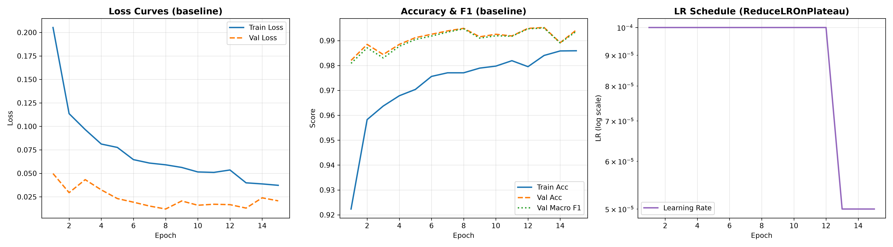
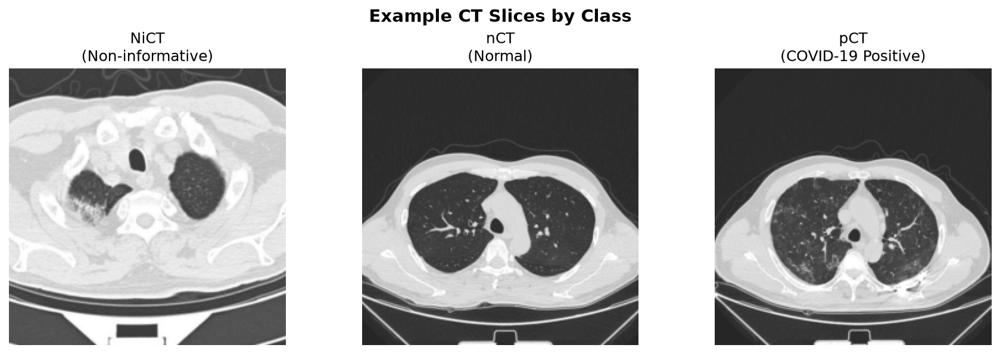
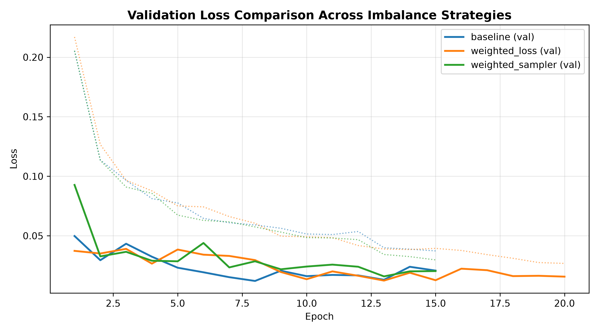
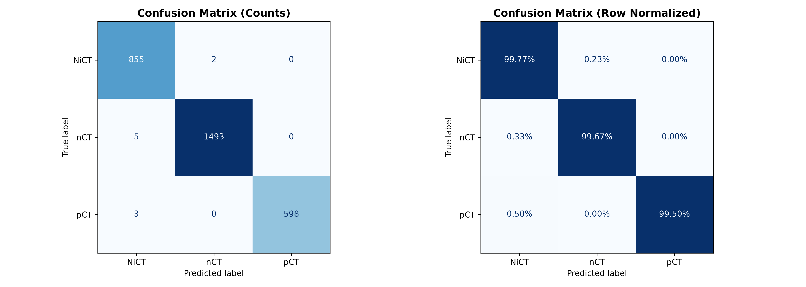
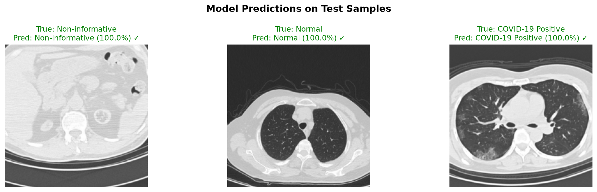
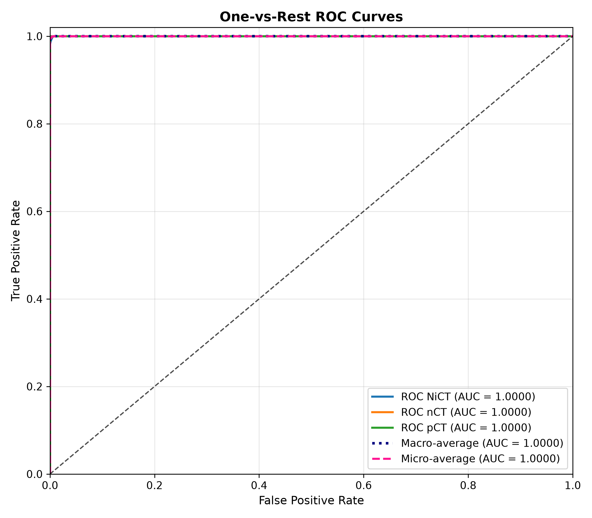
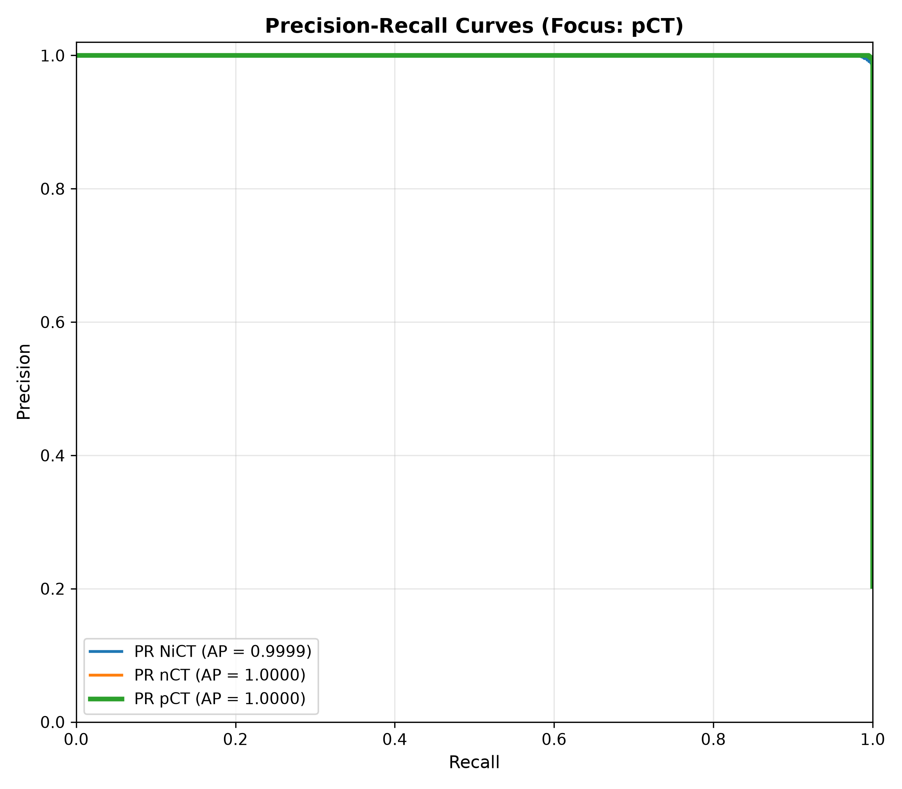
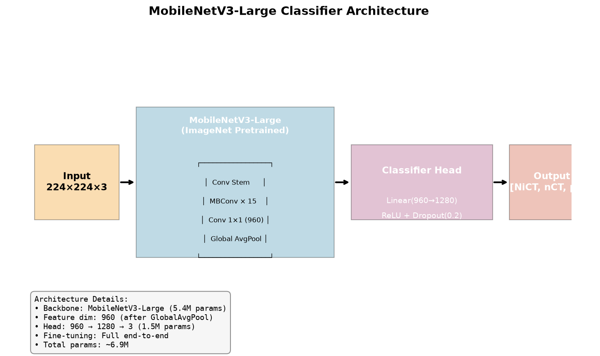

# COVID-19 CT Scan Classifier

A PyTorch image classifier that sorts chest CT slices into three classes: **normal (nCT)**, **COVID-19 positive (pCT)**, and **non-informative (NiCT)**. Built with transfer learning on **MobileNetV3-Large** (full end-to-end fine-tuning), reaching **99.66% accuracy** on a held-out test set of 2,956 slices.



---

## The Task

Classify axial chest CT slices into three diagnostic categories:

| Class | Label | Meaning | Train | Valid | Test | Total |
|-------|-------|---------|-------|-------|------|-------|
| `nCT`  | Normal CT | Lungs visible, no COVID-19 signs | 6,985 | 1,496 | 1,498 | **9,979** |
| `NiCT` | Non-informative CT | Insufficient lung parenchyma visible | 3,993 | 855 | 857 | **5,705** |
| `pCT`  | Positive CT | Ground-glass opacities, consolidations | 2,800 | 600 | 601 | **4,001** |

**Total:** 19,685 slices — stratified 70/15/15 split (seed=42), fixed per-class counts.



> **Patient-Level Independence Limitation**  
> Filenames are sequential indices (`pCT1.jpg`, `pCT2.jpg`...). No patient-to-slice metadata was released. Slices from the same patient may appear across splits. A formal `GroupShuffleSplit` would require curator-released metadata.

---

## Results

### Test Set Performance (Winning Model: Baseline)

| Metric | Value |
|--------|-------|
| **Accuracy** | **99.66%** |
| **Macro F1** | 0.9964 |
| **Micro AUC** | 1.0000 |
| **Macro AUC** | 1.0000 |
| **Test Loss** | 0.0086 |

### Per-Class Classification Report

| Class | Precision | Recall | F1-Score | Support |
|-------|-----------|--------|----------|---------|
| `NiCT` | 0.9907 | 0.9977 | 0.9942 | 857 |
| `nCT` | 0.9987 | 0.9967 | 0.9977 | 1,498 |
| `pCT` | **1.0000** | **0.9950** | **0.9975** | 601 |

### Class Imbalance Experiment (Validation Tournament)

Three strategies compared under identical architecture, seed, and validation protocol:

| Experiment | Val Loss | Macro F1 | pCT Recall | Accuracy |
|------------|----------|----------|------------|----------|
| **Baseline** (CE + Random) | **0.0120** | **0.9947** | **0.9983** | 0.9949 |
| Weighted Loss (Inv-Freq CE) | 0.0123 | 0.9943 | 0.9950 | 0.9949 |
| Weighted Sampler (WRS) | 0.0159 | 0.9944 | 0.9967 | 0.9946 |



**Winner: Baseline** — Standard Cross-Entropy with Random Sampling. The dataset's natural 20% `pCT` prevalence is sufficient; explicit rebalancing adds no benefit and slightly harms calibration.

### Error Analysis

| Error Type | Count |
|------------|-------|
| True `pCT` samples | 601 |
| True Positives (`pCT`→`pCT`) | 598 |
| **False Negatives (`pCT`→`nCT`)** | **0** |
| **False Negatives (`pCT`→`NiCT`)** | **3** |

**Key finding:** Zero `pCT`→`nCT` confusions — the model never mistakes active COVID pathology for normal lung. The 3 false negatives are `pCT`→`NiCT` (poorly visualized lung parenchyma).





### ROC & Precision-Recall Curves





---

## How It Works

### Data
- **Source:** [Kaggle — Preprocessed CT Scans for COVID-19](https://www.kaggle.com/datasets/azaemon/preprocessed-ct-scans-for-covid19) (CC BY 4.0, iCTCF study, Ning et al. 2020)
- **Transforms:** ImageNet normalization; training = RandomResizedCrop + HorizontalFlip; valid/test = CenterCrop
- **Split:** Stratified 70/15/15 with hardcoded per-class counts, seed=42 for full reproducibility

### Model
**Backbone:** MobileNetV3-Large (ImageNet-pretrained, 960-dim features)  
**Head:** `Linear(960→1280) → ReLU → Dropout(0.2) → Linear(1280→3)`  
**Fine-tuning:** **Full** — all convolutional layers unfrozen, backpropagated end-to-end



```python
# Architecture snippet
class Classifier(nn.Module):
    def __init__(self, input_size=960, output_size=3, hidden_layers=[1280], drop_p=0.2):
        layers = []
        prev = input_size
        for h in hidden_layers:
            layers += [nn.Linear(prev, h), nn.ReLU(inplace=True), nn.Dropout(drop_p)]
            prev = h
        layers.append(nn.Linear(prev, output_size))
        self.net = nn.Sequential(*layers)

m = models.mobilenet_v3_large(weights="DEFAULT")
m.classifier = Classifier()  # replaces original 1000-class head
```

### Training
| Parameter | Value |
|-----------|-------|
| Batch Size | 32 |
| Image Size | 224×224 |
| Optimizer | AdamW (lr=1e-4, weight_decay=1e-4) |
| Scheduler | ReduceLROnPlateau (factor=0.5, patience=2) |
| Early Stopping | Patience=4 on val loss |
| Max Epochs | 15 |
| Mixed Precision | Disabled (MPS) |
| Device | Apple Silicon MPS / CUDA / CPU |

**Diagnostics:** Epoch-level validation only (no intra-epoch passes), full checkpointing (best + final + JSON history), training curves saved to `outputs/figures/`.

---

## Getting Started

### Requirements
- Python 3.11+
- PyTorch 2.14+ (with MPS or CUDA)
- 8 GB+ RAM recommended

```bash
# Clone
git clone https://github.com/yourusername/covid-ctscan-ml
cd covid-ctscan-ml

# Virtual environment
python -m venv .venv
source .venv/bin/activate

# Dependencies
pip install -r requirements.txt

# Optional: SHAP for explainability
pip install shap
```

### Get the Data
```bash
# Requires kaggle.json in ~/.kaggle/
kaggle datasets download -d azaemon/preprocessed-ct-scans-for-covid19
unzip preprocessed-ct-scans-for-covid19.zip -d CT_Scan
```

Expected layout:
```
CT_Scan/
└── Original CT Scans/
    ├── nCT/
    ├── NiCT/
    └── pCT/
```

### Train & Evaluate
Open the notebook and run cells sequentially:
```bash
jupyter lab covid_ct_classifier.ipynb
```

**Key controls (Cell 4):**
```python
BATCH_SIZE = 32
EPOCHS = 15
LEARNING_RATE = 1e-4
FINE_TUNING = True           # Full end-to-end fine-tuning
PATIENCE = 4                 # Early stopping patience
FORCE_RETRAIN = False        # True = overwrite existing checkpoints
SMOKE_TEST = False           # True = 1-epoch dry run
```

Outputs saved to `outputs/`:
```
outputs/
├── checkpoints/
│   ├── baseline_best.pt          # Best validation model
│   ├── baseline_final.pt
│   ├── weighted_loss_best.pt
│   └── weighted_sampler_best.pt
├── figures/
│   ├── baseline_training_curves.png
│   ├── experiment_val_loss_comparison.png
│   ├── baseline_confusion_matrix.png
│   ├── baseline_roc_curves.png
│   └── baseline_precision_recall_curves.png
└── reports/
    ├── baseline_history.json
    ├── baseline_classification_report.txt
    └── ...
```

### Using the Trained Model (Inference)
```python
import torch
from torchvision import models, transforms
from PIL import Image
from pathlib import Path

# 1. Load model architecture
device = torch.device("mps" if torch.backends.mps.is_available() else "cpu")
model = models.mobilenet_v3_large(weights=None)
model.classifier = torch.nn.Sequential(
    torch.nn.Linear(960, 1280), torch.nn.ReLU(inplace=True),
    torch.nn.Dropout(0.2), torch.nn.Linear(1280, 3)
)

# 2. Load weights
ckpt = Path("outputs/checkpoints/baseline_best.pt")
model.load_state_dict(torch.load(ckpt, map_location=device))
model.eval().to(device)

# 3. Preprocess
tfm = transforms.Compose([
    transforms.Resize(256),
    transforms.CenterCrop(224),
    transforms.ToTensor(),
    transforms.Normalize([0.485, 0.456, 0.406], [0.229, 0.224, 0.225]),
])

# 4. Predict
img = Image.open("path/to/slice.png").convert("RGB")
x = tfm(img).unsqueeze(0).to(device)
with torch.no_grad():
    probs = torch.softmax(model(x), dim=1).squeeze().cpu().numpy()

classes = ["NiCT", "nCT", "pCT"]
for c, p in zip(classes, probs):
    print(f"{c}: {p*100:.1f}%")
```

---

## Explainability

### Grad-CAM
Hooked to `features[-1]` (final 960-channel conv block). Generates localization heatmaps showing which image regions drove the classification score.

> **Clinical Guardrail:** Heatmaps reflect *model gradient sensitivities*, not validated pathology. A highlighted opacity indicates the region influenced the network's decision — not that the model "understands" COVID-19 radiology.

### SHAP
`GradientExplainer` with 12 representative background samples. Per-class attribution maps showing positive/negative contributions to each logit.

Run in notebook (Cell 36) after training:
```python
import shap
explainer = shap.GradientExplainer(model, background_tensors)
shap_values = explainer.shap_values(test_sample_tensors)
```

---

## Repository Structure

```
covid-ctscan-ml/
├── covid_ct_classifier.ipynb    # Main pipeline (train, eval, explainability)
├── requirements.txt             # Python dependencies
├── README.md                    # This file
├── CT_Scan/                     # Dataset (download separately)
│   └── Original CT Scans/
│       ├── nCT/
│       ├── NiCT/
│       └── pCT/
├── assets/                      # README images (committed to git)
│   ├── baseline_training_curves.png
│   ├── experiment_val_loss_comparison.png
│   ├── baseline_confusion_matrix.png
│   ├── baseline_roc_curves.png
│   ├── baseline_precision_recall_curves.png
│   ├── ct-examples.png
│   ├── example-predictions.png
│   └── mobilenetv3-architecture.png
└── outputs/                     # Generated artifacts (git-ignored)
    ├── checkpoints/
    ├── figures/
    └── reports/
```

---

## Limitations

- **No patient-level split** — slice leakage possible; requires curator metadata for `GroupShuffleSplit`
- **Single-center data** — limited scanner/protocol diversity; validate on external multi-site cohorts
- **2D slice classification** — ignores 3D volumetric context; extend to 3D CNN or slice aggregation
- **Explainability ≠ causality** — Grad-CAM/SHAP show correlations, not mechanisms; debugging only
- **No calibration analysis** — confidence scores may not reflect true probabilities; add temperature scaling
- **Mild class imbalance** — 20% `pCT` may not stress-test rebalancing; test on skewed clinical distributions

> **This model is a research prototype. It has not been validated for clinical use, FDA clearance, or diagnostic decision support. Do not use for patient care.**

---

## Acknowledgements

- **MobileNetV3:** Howard et al., *Searching for MobileNetV3* (ICCV 2019)
- **Grad-CAM:** Selvaraju et al., *Grad-CAM: Visual Explanations from Deep Networks* (ICCV 2017)
- **SHAP:** Lundberg & Lee, *A Unified Approach to Interpreting Model Predictions* (NeurIPS 2017)
- **Dataset:** azaemon (Kaggle), iCTCF study team (Ning et al., 2020) — CC BY 4.0
- **Inspiration:** This project was inspired by [chrispathway/covid-ct-classifier](https://github.com/chrispathway/covid-ct-classifier) — a clean, well-documented baseline that helped shape the structure and evaluation approach here.

---
